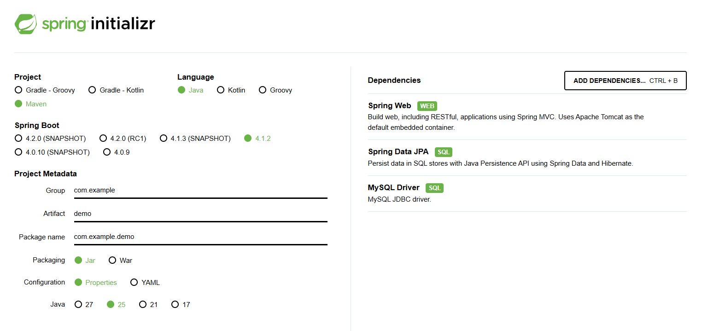
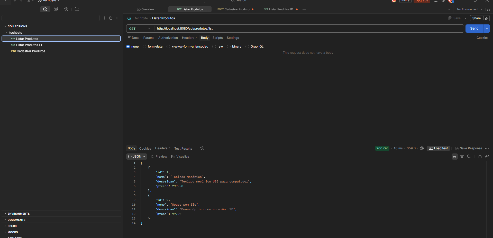
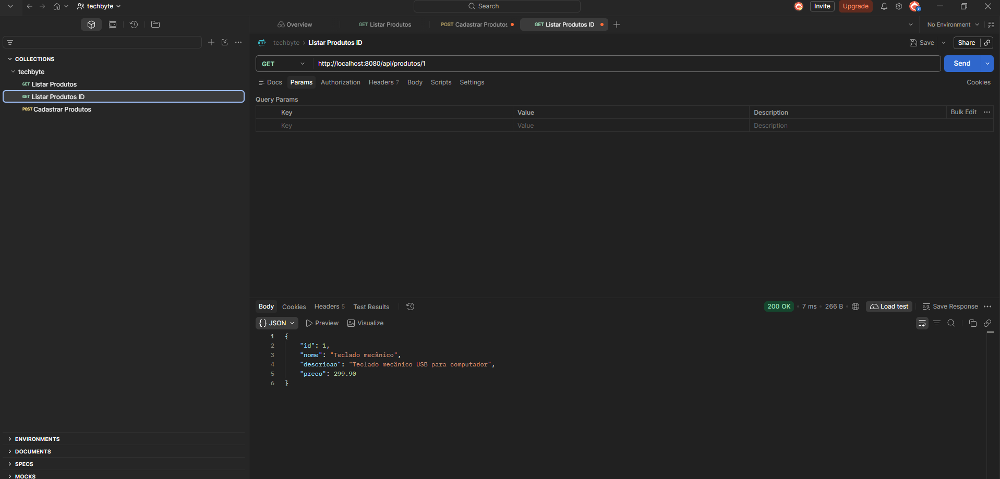
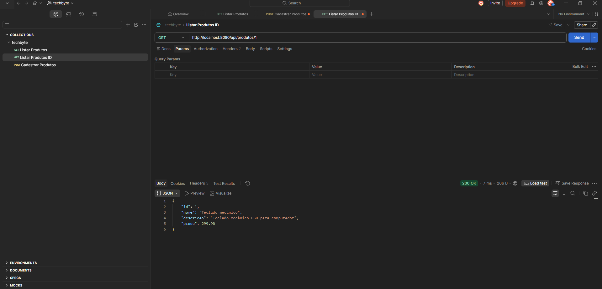

# TechByte-SpringBoot

## Sobre o projeto

Este projeto tem como objetivo realizar a refatoração de uma aplicação
desenvolvida inicialmente em Java puro para uma API utilizando o framework
Spring Boot.

A proposta é migrar a estrutura da aplicação para uma arquitetura baseada em
camadas, permitindo a disponibilização dos dados por meio de endpoints HTTP e a
integração com um banco de dados relacional.

O desenvolvimento faz parte de uma atividade acadêmica que busca aplicar os
conceitos de desenvolvimento de APIs REST com Java e Spring Boot.

## Tecnologias utilizadas

- **Java** - Linguagem de programação.
- **Spring Boot** - Framework para desenvolvimento da API REST.
- **Spring Web** - Criação e disponibilização dos endpoints HTTP.
- **Spring Data JPA** - Persistência e comunicação com o banco de dados.
- **MySQL** - Sistema de gerenciamento de banco de dados.
- **Maven** - Gerenciamento de dependências e construção do projeto.
- **IntelliJ IDEA** - Ambiente de desenvolvimento.

## 1. Criação do projeto com Spring Initializr

O primeiro passo foi criar a estrutura inicial da aplicação utilizando o Spring
Initializr. A ferramenta permite configurar as características do projeto e
selecionar as dependências necessárias para o desenvolvimento.

Acesse: <https://start.spring.io/>

### Configurações utilizadas

- Project: Maven
- Language: Java
- Packaging: Jar
- Java: 17
- Spring Boot: 3.4.5

### Dependências

- Spring Web
- Spring Data JPA
- MySQL Driver

Após selecionar as configurações e dependências, foi realizado o download do
projeto, que posteriormente foi extraído e aberto no IntelliJ IDEA.



## Estrutura do projeto

```text
techbyte/
├── database/
│   └── techbyte_db.sql
├── docs/
│   ├── buscar-por-id-1.png
│   ├── buscar-por-id-2.png
│   ├── cadastrar-produtos.png
│   ├── listar-todos.png
│   └── spring-initializr-configuracao.png
├── src/
│   ├── main/
│   │   ├── java/br/com/victor/techbyte/
│   │   │   ├── TechbyteApplication.java
│   │   │   ├── controller/
│   │   │   ├── dto/
│   │   │   ├── entity/
│   │   │   ├── repository/
│   │   │   └── service/
│   │   └── resources/
│   │       ├── application.properties
│   │       ├── application-local.properties
│   │       └── application-local.properties.example
│   └── test/
│       └── java/br/com/victor/techbyte/controller/
│           └── ProdutoControllerTest.java
├── .gitignore
├── pom.xml
└── techbyte.iml
```

## Como o projeto funciona

O fluxo de uma requisição é:

```text
Cliente
  -> ProdutoController
  -> ProdutoService
  -> ProdutoRepository
  -> MySQL
```

- `ProdutoController`: recebe as requisições HTTP.
- `ProdutoRequest`: valida os dados enviados no cadastro.
- `ProdutoService`: executa as regras da aplicação.
- `ProdutoRepository`: acessa o banco por meio do Spring Data JPA.
- `Produto`: representa a tabela de produtos.
- `ApiExceptionHandler`: transforma erros de validação e produto inexistente
  em respostas HTTP.

## Banco de dados

O arquivo [`database/techbyte_db.sql`](database/techbyte_db.sql) cria o banco
`techbyte_db` e insere dois produtos de exemplo.

Execute o script no MySQL Workbench ou no terminal:

```sql
SOURCE caminho/para/database/techbyte_db.sql;
```

Também é possível abrir o arquivo no MySQL Workbench e executar todo o
conteúdo.

### Tabela de produtos

No código Java e no script SQL, a tabela de produtos usa o mesmo nome:

```java
@Table(name = "produto_ti")
```

O script SQL cria essa tabela no banco `techbyte_db`:

```sql
CREATE TABLE IF NOT EXISTS produto_ti (...);
```

Assim, a aplicação encontra a tabela criada pelo script sem ajustes adicionais.


## Executando a aplicação

Na raiz do projeto, execute:

```powershell
mvn spring-boot:run
```

Quando a aplicação iniciar, a API estará disponível em:

```text
http://localhost:8080
```

O ponto de entrada é a classe:

```text
src/main/java/br/com/victor/techbyte/TechbyteApplication.java
```

## Rotas da API

| Método | URL | Descrição |
|---|---|---|
| GET | `/api/produtos/list` | Lista todos os produtos |
| GET | `/api/produtos/{id}` | Busca um produto pelo ID |
| POST | `/api/produtos` | Cadastra um produto |

### Listar produtos

Requisição:

```http
GET http://localhost:8080/api/produtos/list
```

Resposta de exemplo:



### Buscar produto por ID

Requisição:

```http
GET http://localhost:8080/api/produtos/1
```

Resposta de exemplo:


Imagens registradas no projeto:





### Cadastrar produto

Requisição:

```http
POST http://localhost:8080/api/produtos
```

Corpo JSON:

```json
{
  "nome": "Teclado mecânico",
  "descricao": "Teclado mecânico USB",
  "preco": 299.90
}
```